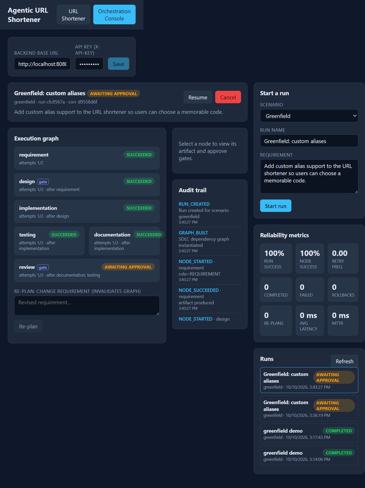
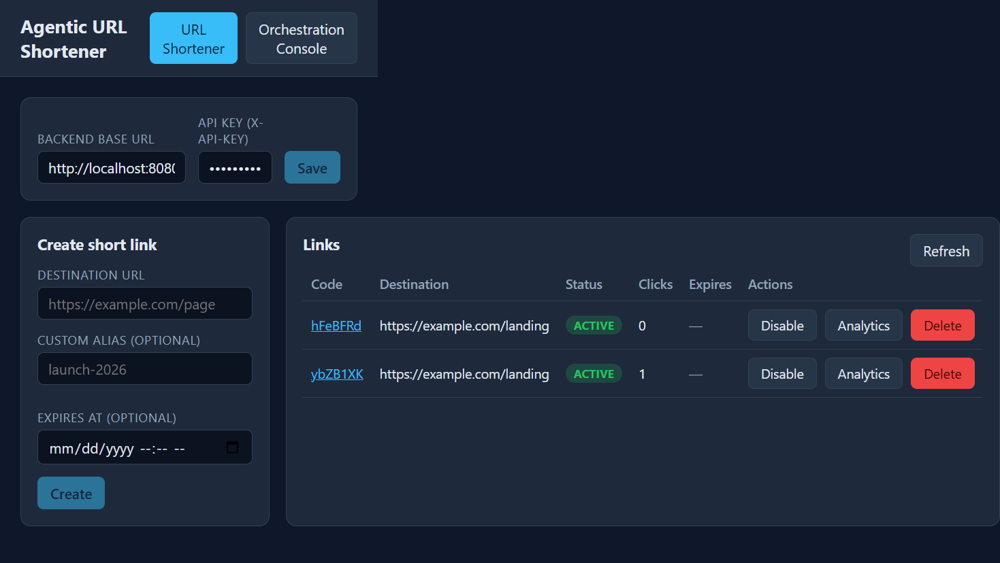
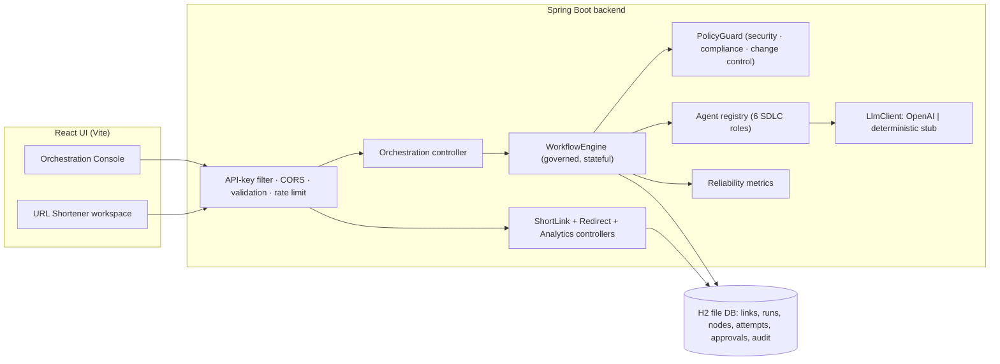
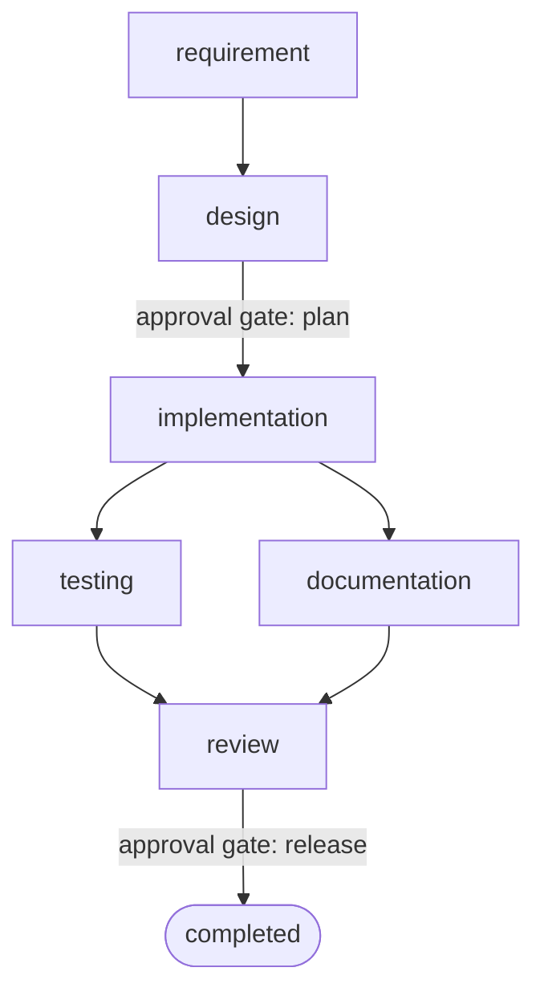

# Agentic URL Shortener

A URL shortener built with an **agentic software-engineering system**: a governed orchestration
engine coordinates the full SDLC (requirements → design → implementation → testing/documentation →
review) as an explicit dependency graph with human approval gates, bounded retries, re-planning,
rollback, safe-stop, audit-grade traceability, and reliability metrics.

Agents execute under defined autonomy boundaries; humans own approvals and final quality control.

- **Backend** — Java 21, Spring Boot 3.3, H2 (file-based, zero external infra). See [backend/README.md](backend/README.md).
- **Frontend** — React + TypeScript + Vite. See [frontend/README.md](frontend/README.md).
- **Engineering summary** — plan, rationale, risks, trade-offs, assumptions, limitations: [docs/ENGINEERING_SUMMARY.md](docs/ENGINEERING_SUMMARY.md).

## Screenshots

**Orchestration console** — live dependency graph, approval gates, audit trail, reliability metrics:



**URL shortener** — create, list, enable/disable, analytics:



## Architecture



### Orchestration graph (per run)



`testing` and `documentation` run in parallel and synchronize at `review`. `design` and `review`
are high-impact gates: the agent produces the artifact, then the node waits in `AWAITING_APPROVAL`
until a human approves (the approval is bound to the artifact's SHA-256 hash). Failures retry up to
a bound, then safe-stop; changing a requirement or artifact invalidates downstream work and forces
re-approval; runs persist and survive restart.

## Prerequisites

- JDK 21 and Maven 3.8+
- Node.js 18+ and npm
- No Docker or database server required

## Run it

Open two terminals.

**1. Backend** (`http://localhost:8080`):

```powershell
cd backend
mvn spring-boot:run
```

**2. Frontend** (`http://localhost:5173`):

```powershell
cd frontend
npm install
npm run dev
```

Open `http://localhost:5173`. In the connection bar set the backend base URL and API key
(`X-Api-Key`, default `local-dev-key`). Use the **Orchestration Console** to start a run and approve
gates; use **URL Shortener** to create and manage links.

### Optional: real LLM

By default agents use a deterministic offline stub so everything runs without credentials. To use
OpenAI, set environment variables before starting the backend (never commit secrets):

```powershell
$env:APP_LLM_PROVIDER = "openai"
$env:OPENAI_API_KEY = "<your key>"
mvn spring-boot:run
```

## Test

```powershell
cd backend
mvn test          # 19 unit + integration tests (URL behavior + orchestration governance)

cd ../frontend
npm run build     # typecheck + production bundle
```

## Three scenarios

- **Greenfield** — "Add custom alias support": runs the full graph; approve `design` then `review`.
- **Brownfield** — "Fix a defect where expired links still redirect": shows impact analysis and
  controlled change management (use rollback + resume on a node).
- **Ambiguous** — "Support branded links and better analytics": the requirement agent flags
  `NEEDS-CLARIFICATION`; use **Re-plan** with a clarified requirement to re-drive the graph.

All three presets are available in the console's **Start a run** panel.

## Limitations (prototype scope)

- Single-node: rate limiter and metrics are in-process; a distributed deployment would use a shared
  store (e.g. Redis).
- Agents produce governed engineering artifacts (text); they do not edit a separate sandboxed repo
  (that would require container isolation, out of scope here).
- H2 + `ddl-auto=update` for zero-setup runnability; a production build would use Flyway on
  PostgreSQL.
- Audit trail is append-only in the same database, not a tamper-evident external store.